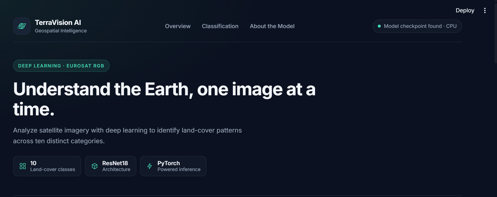
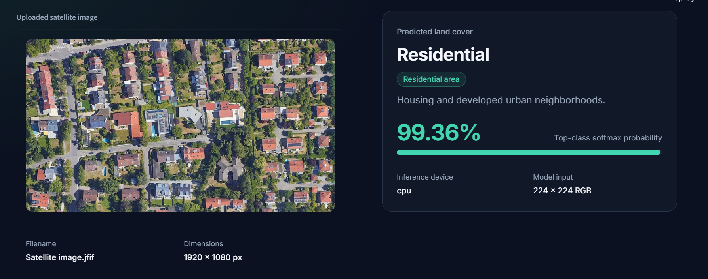
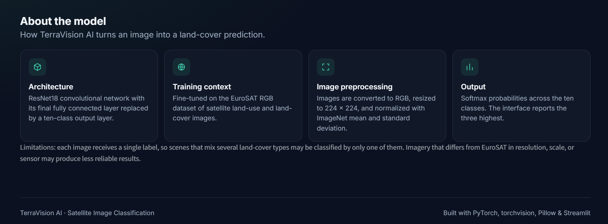

# TerraVision AI — Satellite Image Classification

An AI-powered satellite image classification application built with **PyTorch, ResNet18, and Streamlit**. Upload a satellite image to predict its land-use category and view the model's top predictions with confidence scores.

## Application Screenshots

### 1. TerraVision AI Dashboard



### 2. Satellite Image Classification Results



### 3. Model Information



## Features

- **Deep Learning:** Uses a ResNet18 convolutional neural network.
- **Transfer Learning:** Fine-tuned model for satellite image classification.
- **10 Land-Use Classes:** Classifies satellite images into ten categories.
- **Top-3 Predictions:** Displays the three most likely classes with confidence scores.
- **Interactive Web Interface:** Upload and classify images through a Streamlit application.
- **Image Preprocessing:** Resizes images and applies normalization before inference.

## Technologies Used

- Python
- PyTorch
- Torchvision
- ResNet18
- Streamlit
- Pillow
- EuroSAT RGB Dataset

## Supported Classes

The model predicts one of ten categories:

1. AnnualCrop
2. Forest
3. HerbaceousVegetation
4. Highway
5. Industrial
6. Pasture
7. PermanentCrop
8. Residential
9. River
10. SeaLake

## Project Structure

```text
satellite-image-classification-pytorch/
├── app.py
├── requirements.txt
├── README.md
├── LICENSE
├── .gitignore
├── models/
│   └── best_resnet18_finetuned.pth
├── notebooks/
│   └── satellite_image_classification.ipynb
└── screenshots/
    ├── dashboard.png
    ├── prediction-results.png
    └── model-information.png
```

## Installation and Setup

### 1. Clone the Repository

```bash
git clone https://github.com/Habibullah-Gabol/satellite-image-classification-pytorch.git
cd satellite-image-classification-pytorch
```

### 2. Create a Virtual Environment (Recommended)

```bash
python -m venv .venv
```

Activate it on Windows PowerShell:

```powershell
.venv\Scripts\Activate.ps1
```

### 3. Install Dependencies

```bash
python -m pip install -r requirements.txt
```

### 4. Run the Application

```bash
python -m streamlit run app.py
```

Streamlit will open the application in your browser.

## How to Use

1. Launch the TerraVision AI application.
2. Upload a satellite image in a supported format, such as JPG, JPEG, PNG, WEBP, or JFIF.
3. Wait for the model to process the image.
4. View the predicted land-use category and its confidence score.
5. Explore the top-three predictions and other available application sections.

## Model Information

| Property | Details |
|---|---|
| Architecture | ResNet18 |
| Framework | PyTorch |
| Task | Multiclass image classification |
| Number of classes | 10 |
| Input size | 224 × 224 pixels |
| Dataset | EuroSAT RGB |
| Preprocessing | RGB conversion, resizing, and ImageNet normalization |

The final classification layer is adapted to predict ten satellite image categories. The trained model weights are loaded from `models/best_resnet18_finetuned.pth`.

## Model Performance

The following results are currently reported for the project. Confirm that they correspond to your final held-out test evaluation before treating them as verified results.

| Metric | Reported Result |
|---|---:|
| Test Accuracy | 97% |
| Macro F1-Score | 97% |

- **Accuracy** measures the proportion of correctly classified test images.
- **Macro F1-score** calculates the F1-score for each class and averages the scores equally, giving each class equal weight.

## Important Notes

- The trained model checkpoint must be present at `models/best_resnet18_finetuned.pth`.
- The EuroSAT dataset is not required to run inference if the trained checkpoint is available.
- The application uses the saved model to make predictions; it does not retrain the model whenever an image is uploaded.
- Predictions are estimates and may be less reliable for unfamiliar images or imagery that differs from the training dataset.
- The repository includes the model checkpoint, subject to GitHub file-size limits.

## Future Improvements

- Deploy the application online.
- Add Grad-CAM visualizations to explain model predictions.
- Evaluate performance on satellite images from different sources.
- Optimize inference speed and model size.
- Explore additional land-cover datasets and classification approaches.

## Learning Outcomes

This project demonstrates practical experience with:

- Deep learning and convolutional neural networks
- PyTorch model loading and inference
- ResNet18 and transfer learning
- Image preprocessing and classification
- Building an interactive AI application with Streamlit
- Git, GitHub, and machine learning project organization

## License

Refer to the repository's `LICENSE` file for the project's license. Verify the dataset's licensing and attribution requirements separately.

---

**TerraVision AI** — Turning satellite imagery into meaningful predictions with deep learning.